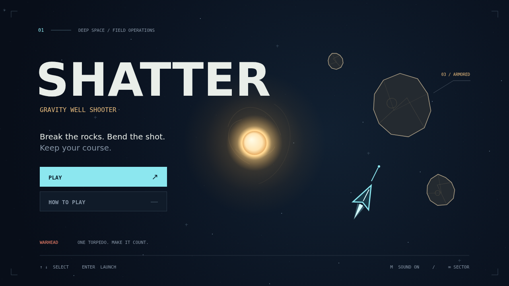

# Shatter

Space doesn't stand still. Pilot a nimble ship through a field of armored rocks,
where a bright star pulls every fragment and bullet into a changing course. Your
ship answers to you. The shot you fired a moment ago answers to gravity.

Break the big rocks, chase down their fragments, and clear the field before the
next wave arrives. Armor cracks under your gunfire, but a heavy rock in your path
may need a more decisive answer: a guided torpedo. Aim into its narrow forward
cone and let it hunt. One charge, ten seconds to reload.

The well is both an obstacle and an opportunity. Curve a shot around its core,
slide your ship along its edge, and watch for rocks returning from the boundary.
Keep an eye on the saucer, too. It has come looking for you.

Keep moving, spend your torpedo wisely, and see how many waves you can survive.
Every shattered rock buys a little breathing room. Every new wave asks for more.

